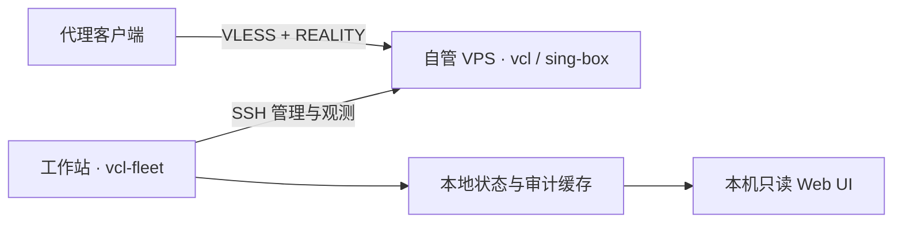

# Vincula（VCL）

Vincula 是一套面向自管 VPS 的代理部署与运维工具。它用 sing-box 提供代理服务，用工作站上的 Controller 集中管理节点和用户，并提供健康监测、故障诊断与近似流量审计。

**当前基线为 0.5.5。** Node 与 Controller 的配套版本已通过 H05，并经 [PR #15](https://github.com/Marz42/vcl/pull/15) 合入 `main`（`9cab4ac`）。该次合并未创建版本标签或 GitHub Release。实机范围、连续跑测及已知限制见 [0.5.5 验收记录](docs/evidence/0.5.5/HUMAN_ACCEPTANCE.md)。

## 功能概览

- **节点管理**。部署空白 VPS、接管已有节点、做原地升级或更换实例。逻辑节点身份与 VPS 实例身份分别管理。
- **用户管理**。在多节点上开通同一逻辑用户，按节点签发、轮换或撤销凭据。
- **运行观测**。通过受限 SSH 采集节点状态，查看服务健康、代理探测结果、配置漂移和事件时间线。
- **流量审计**。同步已结束的连接与流量摘要，按用户、节点和目标汇总。计量来自 sing-box 轮询，适用于运维分析。
- **备份与恢复**。默认使用无密钥备份。需要恢复密钥时，可显式创建加密备份。

## 架构



客户端直接连接 VPS。Controller 通过 SSH 管理节点和同步数据。Web UI 默认只监听 `127.0.0.1:8765`，从本地状态和缓存读取数据。Command Builder 生成可复制的命令，变更从 CLI 执行。

## 兼容性

| 组件 | 0.5.5 支持范围 |
| --- | --- |
| Node（`vcl` / `vincula`） | Debian 12/13、Ubuntu 22.04/24.04/26.04，amd64 / arm64 |
| Controller（`vcl-fleet`） | Windows 11 或 Linux 工作站，Python 3.10+、系统 OpenSSH |
| 配套版本 | Controller 0.5.5 与 Node 0.5.5。旧节点的迁移路径见 [0.5.5 操作手册](docs/operations/0.5.5-closeout-runbook.md) |
| 代理协议 | VLESS + REALITY + `xtls-rprx-vision` + TCP，默认 TCP 443 |
| sing-box | 固定 `1.13.18`，见 [sing-box.lock](sing-box.lock) |

## 快速开始

### 1. 准备 Controller 制品

使用可信渠道提供的同版本 `vincula-controller-<version>.zip`，或按下方「开发与测试」从指定提交构建。先用独立可信的 SHA-256 核对 ZIP，再用包内 `controller.lock` 核对解压内容。在有 `sha256sum` 的环境中，可用配套的 `.zip.sha256` 校验文件运行 `sha256sum -c`。

以下示例在解压目录中执行。Windows 使用 `bin\vcl-fleet.cmd`，路径与命令示例见[用户手册](docs/user-guide.md)。

### 2. 部署一台空白 VPS

从 VPS 控制台等可信渠道核对 SSH 主机指纹。将示例中的 SSH 地址、主机指纹、客户端连接地址和本地密钥路径换成自己的值。部署需要远端 root 或可用的非交互 sudo。

```bash
python3 bin/vcl-fleet version
python3 bin/vcl-fleet init
python3 bin/vcl-fleet node provision myvps \
  --host 203.0.113.10 \
  --host-key 'SHA256:REPLACE_WITH_VERIFIED_FINGERPRINT' \
  --identity-file "$HOME/.ssh/vincula-admin" \
  --server proxy.example.com
```

已有 Vincula 节点用 `node adopt` 接管。仅预登记时用 `node register`，连接后验证身份与状态。

### 3. 开通用户并查看状态

```bash
python3 bin/vcl-fleet user add alice --node myvps
python3 bin/vcl-fleet sync --full
python3 bin/vcl-fleet status
```

在私有终端用 `python3 bin/vcl-fleet user link alice --node myvps` 读取客户端连接 URI。该 URI 含访问凭据。运行 `python3 bin/vcl-fleet ui` 可查看本机仪表盘。启用定期监控前，按[观测手册](docs/operations/monitoring-runbook.md)配置专用 observer 身份。

## 安全与计量

- **身份**。首次接入固定 SSH 主机指纹，管理凭据与受限 observer 凭据分开配置。VCL 连接使用显式 SSH 参数和身份绑定，忽略个人 `~/.ssh/config` 中的跳板、代理命令与别名。
- **访问范围**。Clash API 和管理 UI 默认仅本机可达。使用 bootstrap 时，从可信独立来源固定 `RELEASE_SHA256`。
- **计量口径**。Node 轮询记录流量，Fleet 在连接结束并同步后入账。日汇总按连接开始的 UTC 日期归属，适合趋势与运维分析。分钟级判断使用 Node 遥测。

## 路线图

| 阶段 | 目标 |
| --- | --- |
| **0.5.5 · 已验收** | 受限观测、健康与漂移诊断、schema-5 账本和节点升级恢复 |
| **0.6.x · 开工规格** | 受控配置变更与回滚、告警、逐用户流量规则和 SOCKS5 出口 |
| **0.7.x · 规划** | 自管静态两跳、链路观测、人工批准的主备切换、路径去重计量 |
| **0.8.x 及以后 · 展望** | 按意图推荐路径、有限自动化、长期维护与恢复 |

详见 [0.6.x SPEC](docs/specs/V0.6.x_SPEC.md)、[0.5.x～0.7.x 实施计划](docs/plans/VCL_0.5-0.7_Implementation_Plan.md)和[演进白皮书](docs/specs/VCL_Post_0.7_Whitepaper.md)。

## 文档

| 需求 | 入口 |
| --- | --- |
| 安装、配置与日常使用 | [用户手册](docs/user-guide.md) |
| 兼容性、身份、状态与技术合同 | [技术手册](docs/technical-guide.md) |
| 0.5.5 升级、恢复与容量处理 | [0.5.5 操作手册](docs/operations/0.5.5-closeout-runbook.md) |
| 监控、探针和 observer | [观测手册](docs/operations/monitoring-runbook.md) |
| 配置检查与漂移 | [Inspect、Drift 与 Verify](docs/operations/inspect-runbook.md) |
| 更换 VPS | [节点替换手册](docs/operations/node-replace-runbook.md) |
| 规格、验收与历史 | [文档导航](docs/README.md) · [版本历史](CHANGELOG.md) |

## 开发与测试

在 Linux 上运行仓库测试与构建脚本。制品和校验文件输出到 `dist/`。

```bash
bash tests/test.sh
bash scripts/build-release.sh
bash scripts/build-controller.sh
```

`build-release.sh` 会更新节点发布清单。Controller ZIP 可独立解压使用，包含配套 Node payload。构建与兼容性检查见 [CI 配置](.github/workflows/ci.yml)。
